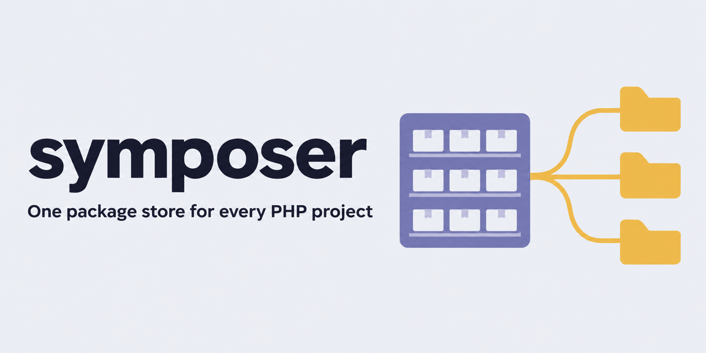

<p align="center">
  <a href="https://mello21century.github.io/symposer/"></a>
</p>

<p align="center">
  <a href="https://github.com/Mello21century/symposer/actions/workflows/ci.yml"></a>
  <a href="https://github.com/Mello21century/symposer/releases/latest"></a>
  
  
  <a href="LICENSE"></a>
</p>

<p align="center">
  <a href="https://mello21century.github.io/symposer/"><b>Website</b></a> ·
  <a href="https://mello21century.github.io/symposer/docs.html"><b>Docs</b></a> ·
  <a href="https://github.com/Mello21century/symposer/releases"><b>Releases</b></a>
</p>

# symposer

:package: **A pnpm-style package store for Composer.** Every package version is stored **once** in `~/.symposer/store/`, and each project's `vendor/` links into it.

:floppy_disk: A second Laravel project's `vendor/` uses about **2.6 MB of new disk instead of ~77 MB**.

:handshake: Composer still does the real work: resolution, `composer.lock`, private repos, plugins, scripts and autoload all behave as before.

## :rocket: Installation

**Requirements:** PHP 7.2.5+ on your `PATH` (or set `SYMPOSER_PHP`). You do not need Composer installed: symposer downloads its own pinned, checksum-verified `composer.phar` on first run.

### :apple: :penguin: macOS / Linux
```sh
curl -fsSL -o symposer "https://github.com/Mello21century/symposer/releases/latest/download/symposer-$(uname -s | tr A-Z a-z)-$(uname -m | sed 's/x86_64/amd64/;s/aarch64/arm64/')"
chmod +x symposer && sudo mv symposer /usr/local/bin/
symposer store status
```
This picks the right binary for your OS and CPU. You can also download one by hand from the [Releases page](https://github.com/Mello21century/symposer/releases).

### :window: Windows (PowerShell)
```powershell
$dir = "$env:LOCALAPPDATA\symposer"; New-Item -ItemType Directory -Force $dir | Out-Null
Invoke-WebRequest https://github.com/Mello21century/symposer/releases/latest/download/symposer-windows-amd64.exe -OutFile "$dir\symposer.exe"
$userPath = [Environment]::GetEnvironmentVariable("Path", "User")
[Environment]::SetEnvironmentVariable("Path", "$userPath;$dir", "User")   # then open a new terminal
symposer store status
```

### :hammer_and_wrench: With Go (1.23+)
```sh
go install github.com/Mello21century/symposer@latest
```
This puts `symposer` in `$(go env GOPATH)/bin`. Make sure that directory is on your `PATH`.

### :white_check_mark: Verify
```sh
symposer store status   # prints version, store location, package count
symposer --version      # prints the Composer and PHP versions symposer runs
```

## :keyboard: Usage

```sh
symposer install            # instead of: composer install
symposer update             # instead of: composer update
symposer require foo/bar    # any composer command works the same way
symposer store status       # store location, package count, size
symposer store prune        # delete store versions no project uses (--dry-run to preview)
```

### :elephant: Choosing the PHP version
symposer is a native binary, so `php74 symposer install` does **not** work: PHP can't run it. Set `SYMPOSER_PHP` to the PHP you want, either a command on your `PATH` or a full path. Composer then runs on that PHP, so dependency resolution and platform checks match it. Any PHP from **7.2.5** up works.

Say your machine's default is PHP 8.3 and a project needs PHP 7.4:

```sh
SYMPOSER_PHP=php7.4 symposer install            # Debian/Ubuntu (ondrej PPA) naming
SYMPOSER_PHP=php74 symposer install             # Laravel Herd naming
SYMPOSER_PHP=/opt/homebrew/opt/php@7.4/bin/php symposer install   # Homebrew (shivammathur/php)

export SYMPOSER_PHP=php74                       # or: every symposer call in this shell
alias symposer74='SYMPOSER_PHP=php74 symposer'  # or: a shortcut in ~/.zshrc / ~/.bashrc
```

```powershell
$env:SYMPOSER_PHP = "C:\php74\php.exe"; symposer install     # Windows PowerShell
```
```bat
set SYMPOSER_PHP=C:\php74\php.exe && symposer install         :: Windows cmd
```

To check which PHP is used, run `SYMPOSER_PHP=php74 symposer --version`.

Packages for different PHP versions share the store safely. Each one is keyed by its exact version and commit, so a PHP 7.4 project and a PHP 8.3 project link to whichever versions their own lock files ask for.

## :gear: How it works
symposer is a single Go binary. It runs Composer's real install and update pipeline (a pinned, sha256-verified `composer.phar`, downloaded once), with one change: the archive downloaders are wrapped (`shim/symposer.php`).

- :link: **Store hit:** `vendor/<vendor>/<name>` becomes a link to `store/<vendor>/<name>/<version>-<ref>/` (a symlink, or a junction on Windows, which needs no admin rights).
- :inbox_tray: **Store miss:** Composer downloads it as usual (auth, cache, mirrors), extracts it into the store, then links it.
- :paperclip: **Packages with `bin` entries** get a *hardlinked* tree instead: a real dir whose files are hardlinks to the store. Bin scripts like Pest's find `vendor/autoload.php` through `__DIR__`, which PHP resolves through symlinks.

Composer still does everything else, so these work unchanged: resolution, `composer.lock`, private repos and `auth.json`, plugins and their events, `installer-paths`, scripts (`post-autoload-dump`, ...), `installed.php` and `vendor/bin`.

| package kind | result in vendor |
|---|---|
| normal dist package | symlink / junction → store |
| package with `bin` | hardlinked tree from store |
| `path` repository | Composer's own symlink to your local package (never stored) |
| `--prefer-source` / git source | normal clone (never stored) |
| excluded or patched (`extra.patches`) | normal copy |

:broom: Updating a package never deletes the old version, since another project may still use it. Each run records which versions the project uses, and `symposer store prune` deletes the ones no project uses anymore (including those of deleted projects). Projects last installed with symposer < 0.2.0 aren't recorded yet: run `symposer install` in them once before pruning.

:lock: Store files are made read-only (except on Windows), so a package that writes into itself fails loudly instead of changing every project that shares it.

## :no_entry_sign: Opting packages out
```json
"extra": { "symposer": { "exclude": ["vendor/package"] } }
```
Packages patched by `cweagans/composer-patches` (`extra.patches`, `patches-file`, `patches.json`) are excluded automatically.

## :wrench: Environment
| var | default |
|---|---|
| `SYMPOSER_HOME` | `~/.symposer` |
| `SYMPOSER_PHP` | `php` on PATH |
| `SYMPOSER_COMPOSER` | pinned phar (other versions at your own risk) |

## :books: Documentation
The full guide, with troubleshooting and store details, is at **[mello21century.github.io/symposer/docs.html](https://mello21century.github.io/symposer/docs.html)**.

## :raising_hand: Contributing
Contributions are welcome! :tada:

- :bug: **Found a package that breaks when linked?** [Open an issue](https://github.com/Mello21century/symposer/issues) with the package name and the error. That alone is a big help.
- :bulb: **Have an idea or a larger change?** Open an issue first so we can agree on the approach.
- :arrow_heading_up: **Sending a pull request?** Run the e2e suite before you push:

```sh
git clone https://github.com/Mello21century/symposer.git && cd symposer
go build -o bin/symposer .
e2e/run.sh bin/symposer                  # needs php + network
E2E_LARAVEL=1 e2e/run.sh bin/symposer    # adds a full Laravel + Pest run
```

| file | what it does |
|---|---|
| `main.go` | CLI: finds PHP, downloads the pinned Composer, implements `store` |
| `shim/symposer.php` | the store logic running inside Composer. Keep it PHP 7.2.5 compatible |
| `e2e/run.sh` | end-to-end suite. CI runs it on Linux, macOS and Windows, PHP 7.2 to 8.4 |
| `docs/` | the website (GitHub Pages) |

## :sparkles: Contributors
Thanks to everyone who has helped build symposer! :heart:

<a href="https://github.com/Mello21century/symposer/graphs/contributors">
  
</a>

## :page_facing_up: License
[MIT](LICENSE) © 2026 Ahmed Safaa

---

<p align="center">If symposer saves you disk space, a :star: on the repo helps others find it.</p>
